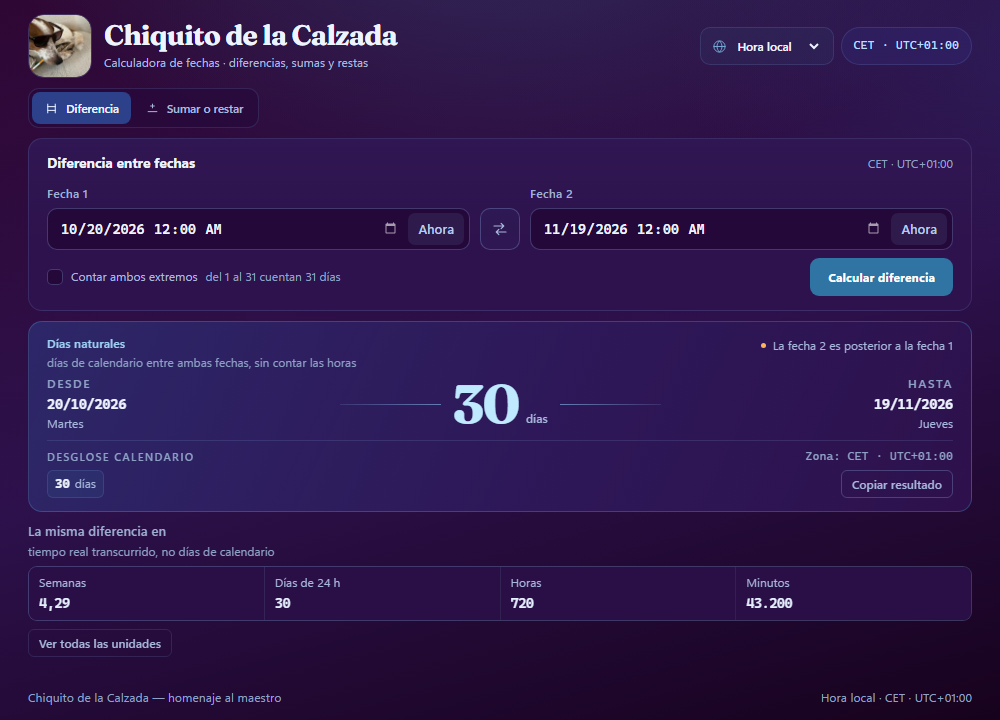

<div align="center">
  
  <h1>Chiquito de la Calzada</h1>
  <p><strong>Calculadora de fechas</strong> · diferencias, sumas y restas · escritorio y CLI</p>
</div>



Calculadora de fechas escrita en **Go**. Calcula la diferencia entre dos
momentos, la desglosa en años, meses, días, horas, minutos y segundos, y permite
sumar o restar duraciones. Incluye una aplicación de escritorio (Wails +
WebView2) y una herramienta de línea de comandos. Todo el cálculo ocurre en Go:
la interfaz es una página estática embebida en el ejecutable, sin Node, npm ni
conexión a internet.

## Qué puedes hacer

- **Diferencia entre fechas** con fecha y hora (hasta milisegundos), botón
  «Ahora», intercambio de fechas y opción de contar ambos extremos.
- **Días naturales** en grande, con el desglose exacto y la relación entre las
  fechas.
- **La misma diferencia en** años, meses, semanas, días de 24 h, horas, minutos,
  segundos y milisegundos; en la GUI se muestran primero las relevantes para la
  magnitud y el resto queda plegado.
- **Sumar o restar** una duración a una fecha base, con resultado legible e
  ISO 8601.
- **Edad y días de vida**: los días vividos son el número principal (con su
  equivalente en semanas), la edad exacta pasa al detalle, y se añaden la próxima
  celebración y el ajuste especial para los nacidos el 29 de febrero. La fecha
  de referencia puede ser hoy o cualquier otro día.
- **Días laborables**: cuenta de lunes a viernes entre dos fechas, con packs de
  festivos de España, México, Colombia y Argentina, festivos sueltos y suma o
  resta de días laborables.
- **Conversor de zonas**: la misma hora de pared en otra ciudad, con avisos de
  horas inexistentes o repetidas por el cambio de hora.
- **Ficha de la fecha**: día de la semana, semana ISO, día del año, trimestre,
  días que quedan del mes y del año, y año bisiesto.
- **Zonas horarias IANA** con offset y horario de verano; el catálogo se genera
  desde `zone1970.tab` y viaja dentro del ejecutable.
- **Historial y favoritos** en la GUI, y **exportación a `.ics`** de cualquier
  fecha para el calendario.
- **Salida JSON** en la CLI para integrarla en otros scripts.

## La aplicación de escritorio

Pensada para Windows 10/11. Descarga `chiquito_de_la_calzada.exe` desde
[Releases](https://github.com/AzuelZero/chiquito_de_la_calzada/releases) y ábrelo;
no necesita instalación. WebView2 suele venir con Windows y, si falta, Windows lo
ofrece al arrancar la aplicación.

La ventana mide 1000 × 760 y se puede redimensionar. Tiene seis pestañas:
**Diferencia**, **Sumar o restar**, **Edad**, **Laborables**, **Conversor** y
**Ficha**.

- El selector superior es la **zona de cálculo**: se aplica a todas las fechas
  de la app. La pastilla de al lado muestra la abreviatura y el offset actuales
  (`CET · UTC+01:00`, `CEST · UTC+02:00`…).
- El selector **Al cambiar: hora escrita / momento real** decide qué pasa con
  las horas al cambiar la zona de cálculo: conservar la hora de pared o
  conservar el instante real. Si escribes una zona desconocida, el error se
  queda bajo la cabecera hasta que la corrijas.
- La pestaña **Conversor** es independiente del ajuste anterior: sirve para ver
  la misma hora en otra ciudad y avisa de las horas inexistentes o repetidas por
  el cambio de hora.
- Al abrir se calculan los últimos 30 días como ejemplo.
- La fecha y la hora se interpretan en la zona elegida, no en la del navegador.
- El botón «Ahora» usa la hora real de esa zona.
- Al editar una fecha, el resultado se recalcula solo; si algo falla, el
  resultado anterior no desaparece de la pantalla.
- El panel de unidades muestra las 4 relevantes para la magnitud calculada;
  «Ver todas las unidades» despliega las demás.
- En «Sumar o restar», Enter repite la última operación usada y el resultado
  también se puede copiar.
- Los sonidos reales de Chiquito acompañan las acciones explícitas: **¡JARL!**
  al intercambiar fechas o activar el sonido, **¡Al ataque!** en las sumas y los
  días laborables, **¡Fuegorrrlll!** al calcular los días de vida, **¡Epetekan!**
  al convertir zonas, **¿Te das cuen?** en la ficha y **¡Camarerooorrrlll!** al
  copiar o guardar. Los errores de validación nunca suenan. El audio viaja dentro
  del ejecutable: no necesita conexión. El botón «Sonido» silencia todos los
  sonidos y recuerda la elección.
- El botón **Historial** guarda las últimas operaciones y permite fijar
  diferencias como favoritas para recuperarlas con un clic.
- **Exportar .ics** abre el diálogo nativo de Windows y guarda un evento de
  calendario compatible con Outlook, Google Calendar y Apple Calendar.
- La zona, las fechas, la pestaña activa y el estado del sonido se conservan al
  cerrar y volver a abrir.
- Los avisos de horario de verano aparecen bajo el formulario correspondiente:
  - **Hora inexistente** al adelantar el reloj: se indica cómo la interpreta Go
    (por ejemplo, `02:30` se convierte en `03:30`).
  - **Hora repetida** al atrasar el reloj: se indica cuál de las dos
    ocurrencias se ha tomado.
- El pie muestra la zona activa y la versión de la aplicación.

El diseño usa una paleta azul-violeta, la tipografía **Fraunces** para el título
y las cifras principales, y Segoe UI para el resto.

## Zonas horarias y horario de verano

La base de datos IANA viaja dentro del ejecutable mediante `time/tzdata`, así
que las zonas funcionan aunque Windows no tenga esos datos instalados. El
catálogo de 312 zonas canónicas se genera con `tools/zonegen` a partir de
`zone1970.tab`. El horario de verano se aplica automáticamente: la misma hora de
pared puede tener un offset distinto según la fecha.

Ese cambio también afecta a la aritmética. Entre el 29 de marzo de 2026 a las
01:30 y las 04:30 en Madrid solo hay **2 horas**, no 3, porque de 02:00 a 03:00
no existe:

```text
$ chiquito_de_la_calzada_cli 2026-03-29T01:30 2026-03-29T04:30 --tz Europe/Madrid
Zona: Europe/Madrid (CET, UTC+01:00)

Fecha 1: 29/03/2026 01:30:00 (domingo)
Fecha 2: 29/03/2026 04:30:00 (domingo)

La fecha 2 es posterior a la fecha 1.
Diferencia: 2 horas
Días naturales: 0 (29/03/2026 → 29/03/2026)
```

Por eso los **días naturales** y los **días de 24 h** pueden no coincidir: los
primeros cuentan días de calendario y los segundos, tiempo real transcurrido.

En la CLI, `--tz` elige la zona y `--utc` fuerza UTC. No se pueden usar juntos.
La GUI avisa de las horas ambiguas o inexistentes; la CLI aplica las reglas de
Go para la zona indicada.

## Línea de comandos

El binario de la CLI se publica como `chiquito_de_la_calzada_cli.exe` (amd64) y
`chiquito_de_la_calzada_cli_arm64.exe`. También puedes compilarlo con las
instrucciones del final.

```text
chiquito_de_la_calzada_cli                        Modo interactivo
chiquito_de_la_calzada_cli <fecha1>               Diferencia con hoy
chiquito_de_la_calzada_cli <fecha1> <fecha2>      Diferencia entre fechas
chiquito_de_la_calzada_cli diff <fecha1> <fecha2> Igual que arriba
chiquito_de_la_calzada_cli add <fecha> <duración> Sumar una duración
chiquito_de_la_calzada_cli sub <fecha> <duración> Restar una duración
chiquito_de_la_calzada_cli age <nacimiento> [fecha]     Edad y cumpleaños
chiquito_de_la_calzada_cli workdays <fecha1> <fecha2>   Días laborables
chiquito_de_la_calzada_cli addworkdays <fecha> <días>   Sumar días laborables
chiquito_de_la_calzada_cli facts <fecha>          Ficha de calendario
chiquito_de_la_calzada_cli convert <fecha> <origen> <destino>
chiquito_de_la_calzada_cli ics <fecha> [título]   Exportar evento .ics

Opciones:
  -u, --utc              Interpretar las fechas en UTC
  -z, --tz <zona>        Zona IANA, p. ej. Europe/Madrid o America/Bogota
  -j, --json             Salida en JSON
  -i, --inclusive        Contar ambos extremos en los días naturales
      --country <clave>  Festivos: es, mx, co, ar
      --holiday <fecha>  Festivo suelto; se puede repetir
      --out <archivo>    Guardar el .ics en un archivo
      --all-day          Crear el .ics como evento de día completo
      --list-zones       Listar zonas IANA disponibles
      --version          Mostrar la versión
  -h, --help             Mostrar la ayuda
```

El código de salida es **2** para un uso incorrecto (opciones o argumentos no
válidos) y **1** para errores de datos o de ejecución. Así se puede usar en
scripts sin analizar el texto.

### Ejemplos

```sh
# Diferencia entre dos fechas en Madrid
chiquito_de_la_calzada_cli 2026-01-01 2026-03-15 --tz Europe/Madrid

# La misma diferencia en JSON
chiquito_de_la_calzada_cli diff 2026-01-01 2026-03-15 --json

# Sumar y restar duraciones
chiquito_de_la_calzada_cli add 2026-01-31 "1 mes"        # 28/02/2026
chiquito_de_la_calzada_cli sub "2026-03-15 18:00" 45min

# Edad exacta, días de vida y próximo cumpleaños
chiquito_de_la_calzada_cli age 1990-06-15

# Días laborables en España, con un festivo extra
chiquito_de_la_calzada_cli workdays 2026-12-01 2026-12-31 --country es --holiday 2026-12-24

# Sumar 10 días laborables
chiquito_de_la_calzada_cli addworkdays 2026-11-23 10 --country es

# Ficha de una fecha
chiquito_de_la_calzada_cli facts 2026-11-23

# Convertir una hora entre zonas
chiquito_de_la_calzada_cli convert "2026-11-23 12:00" Europe/Madrid America/Bogota

# Guardar un evento de calendario
chiquito_de_la_calzada_cli ics 2026-12-24 "Nochebuena" --out nochebuena.ics

# Modo interactivo
chiquito_de_la_calzada_cli
```

Salida de ejemplo:

```text
Zona: Europe/Madrid (CET, UTC+01:00)

Fecha 1: 01/01/2026 00:00:00 (jueves)
Fecha 2: 15/03/2026 00:00:00 (domingo)

La fecha 2 es posterior a la fecha 1.
Diferencia: 2 meses y 14 días
Días naturales: 73 (01/01/2026 → 15/03/2026)

Totales:
  Años (365,2425 días)                    0,2
  Meses (30,436875 días)                  2,4
  Semanas                               10,43
  Días (24 h)                              73
  Horas                                 1.752
  Minutos                             105.120
  Segundos                          6.307.200
  Milisegundos                  6.307.200.000
```

### Formatos aceptados

- **Fechas:** `2026-11-18`, `18/11/2026`, `18-11-2026`,
  `2026-11-18 14:30`, `18/11/2026 14:30:05`, RFC 3339, `hoy`, `ahora`,
  `mañana`, `ayer`, `en 3 días`, `hace una semana`, `el próximo lunes` o
  `18 de noviembre de 2026`.
- **Duraciones:** `1a 2mes 3sem 4d 5h 6min 7s 250ms`. También se aceptan
  `1y 2mo 3w 4d 5h 6m 7s`, un número suelto (días) y signos negativos:
  `-2d`, `-1mes`.
- Al sumar meses, el día se ajusta al último del mes de destino: el 31 de enero
  más un mes es el 28 de febrero (o el 29 en un año bisiesto).

## Compilar

Requisitos: **Go 1.26 o superior**. Para la GUI, Windows 10/11 y el runtime de
WebView2.

```sh
git clone https://github.com/AzuelZero/chiquito_de_la_calzada.git
cd chiquito_de_la_calzada

# CLI
go build -o chiquito_de_la_calzada_cli.exe .

# Aplicación de escritorio
go build -tags "gui desktop production" -ldflags "-H windowsgui -s -w" -o chiquito_de_la_calzada.exe ./gui
```

Para que la aplicación muestre su versión, inyecta el valor en la compilación:

```sh
go build -ldflags "-X main.version=1.2.0" -o chiquito_de_la_calzada_cli.exe .
go build -tags "gui desktop production" \
  -ldflags "-H windowsgui -s -w -X main.version=1.2.0" \
  -o chiquito_de_la_calzada.exe ./gui
```

Para compilar la GUI de Windows ARM64:

```sh
GOOS=windows GOARCH=arm64 CGO_ENABLED=0 \
  go build -tags "gui desktop production" \
  -ldflags "-H windowsgui -s -w -X main.version=1.2.0" \
  -o chiquito_de_la_calzada_arm64.exe ./gui
```

El icono del ejecutable se enlaza desde `gui/rsrc.syso`. Si cambias el logo,
regenera el `.ico` y el recurso:

```sh
go run tools/icogen/main.go assets/logo.png gui/app.ico
go run github.com/akavel/rsrc@latest -ico gui/app.ico -o gui/rsrc.syso
# Para ARM64:
go run github.com/akavel/rsrc@latest -arch arm64 -ico gui/app.ico -o gui/rsrc.syso
```

El `.syso` versionado es amd64. Para compilar ARM64 con icono hay que
regenerarlo con `-arch arm64` (el flujo de release lo hace solo).

## Pruebas

```sh
go test ./...                                  # CLI, datecore y fuzz seeds
go test -tags "gui desktop production" ./gui   # backend de la GUI y DST

# Fuzz manual (opcional)
go test -run=^$ -fuzz=FuzzParseDelta -fuzztime=30s ./datecore
go test -run=^$ -fuzz=FuzzBuildICS -fuzztime=30s ./datecore

# Vulnerabilidades conocidas
go run golang.org/x/vuln/cmd/govulncheck@latest -tags "gui desktop production" ./...
```

La GUI vive detrás del tag `gui` para que el resto del proyecto se pueda probar
sin compilar Wails.

## Integración continua y releases

El repositorio incluye dos flujos de GitHub Actions:

- **`.github/workflows/ci.yml`** se ejecuta en cada `push` a `main`, en cada
  pull request y a mano. Instala la última revisión de Go 1.26, comprueba
  `gofmt`, pasa `go vet`, las pruebas de `datecore`, CLI y GUI, ejecuta un Fuzz
  de humo durante 15 segundos, busca vulnerabilidades con `govulncheck` y
  compila la CLI y la GUI para amd64 y arm64.
- **`.github/workflows/release.yml`** se ejecuta al empujar una etiqueta `v*`.
  Compila en paralelo amd64 y arm64, regenera el recurso de icono para cada
  arquitectura, inyecta la versión (sin la `v`) en los binarios, calcula
  `SHA256SUMS.txt` y publica la release con las notas generadas por GitHub.

Para publicar una versión nueva:

```sh
git add .
git commit -m "v1.2.0: edad, laborables, zonas, ficha e ICS"
git push origin main
git tag -a v1.2.0 -m "Chiquito de la Calzada v1.2.0"
git push origin v1.2.0
```

La release queda con estos archivos:

```text
chiquito_de_la_calzada.exe          GUI amd64
chiquito_de_la_calzada_cli.exe      CLI amd64
chiquito_de_la_calzada_arm64.exe    GUI arm64
chiquito_de_la_calzada_cli_arm64.exe CLI arm64
SHA256SUMS.txt                      hashes de los cuatro binarios
```

No hace falta configurar secretos: el flujo usa el `GITHUB_TOKEN` del propio
repositorio, con permiso de escritura sobre las releases.

## Estructura

```text
.
├── .github/workflows/   CI y publicación de releases
├── datecore/            Lógica compartida: fechas, zonas, festivos, edad e ICS
│   ├── zones_data.go    Catálogo IANA generado
│   └── fuzz_test.go     Pruebas de fuzzing
├── gui/                 Aplicación Wails
│   ├── frontend/dist/   HTML, CSS, JS, logo, fuente Fraunces y audio
│   ├── app.ico          Icono multi-resolución
│   └── rsrc.syso        Recurso de icono para el .exe (amd64)
├── tools/icogen/        Generador Go del .ico
├── tools/zonegen/       Generador del catálogo de zonas
├── assets/              Logo y captura para la documentación
│   └── propuestas/      Comparativa del logo y propuestas vectoriales
├── main.go              CLI
├── main_test.go         Pruebas de la CLI
└── README.md
```

## Créditos

- **Logo:** fotografía propia. La comparativa con las propuestas vectoriales
  está en `assets/propuestas/`.
- **Sonidos:** varias citas breves de Chiquito de la Calzada tomadas de Tonos
  Móvil: [el grito](https://tonosmovil.net/chiquito-de-la-calzada-grito/),
  [al ataque](https://tonosmovil.net/chiquito-de-la-calzada-al-ataque/),
  [fuego](https://tonosmovil.net/chiquito-de-la-calzada-fuegorrrlll/),
  [camarero](https://tonosmovil.net/chiquito-de-la-calzada-camarerorrrlll/),
  [¿te das cuen?](https://tonosmovil.net/chiquito-de-la-calzada-te-das-cuen/) y
  [epetekan](https://tonosmovil.net/chiquito-epetekan/).
  Están recortados y normalizados para la interfaz. Se incluyen como cita breve
  de homenaje; los derechos sobre la voz y las grabaciones pertenecen a sus
  titulares.
- **Fraunces:** tipografía de Undercase Type, bajo SIL Open Font License 1.1.
  La licencia está en
  [`gui/frontend/dist/assets/fonts/OFL.txt`](gui/frontend/dist/assets/fonts/OFL.txt).
- **Wails:** framework de escritorio para Go.
- **Nombre:** homenaje a Chiquito de la Calzada. Proyecto independiente, sin
  relación con el humorista ni sus herederos.

## Licencia

[MIT](LICENSE) © 2026 Azuel.
